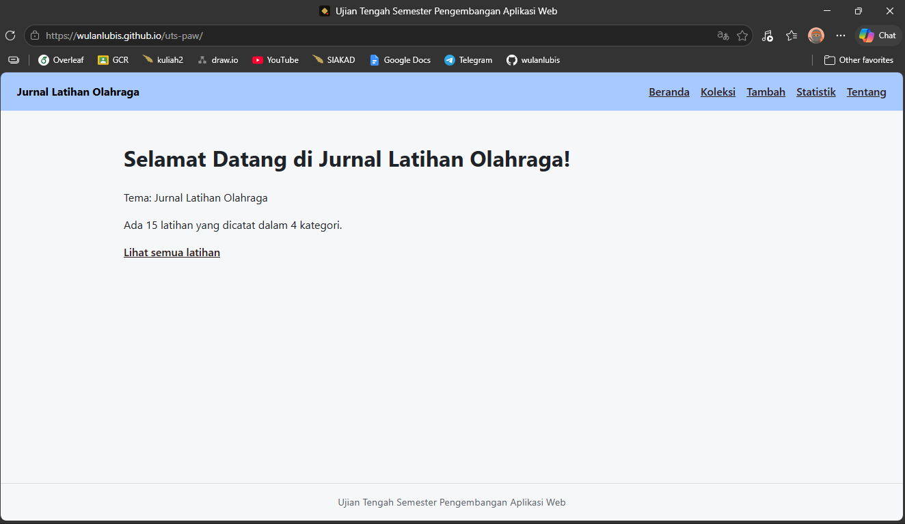
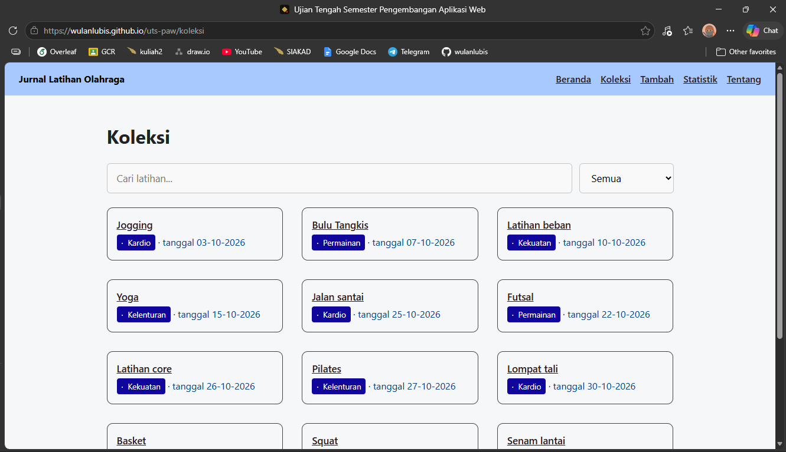
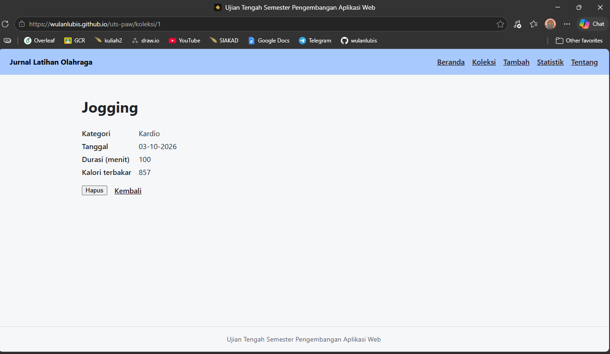
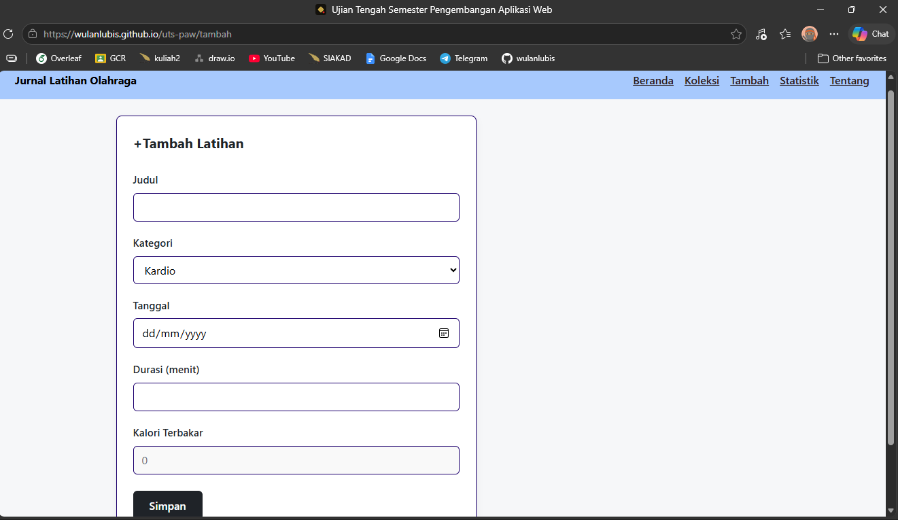
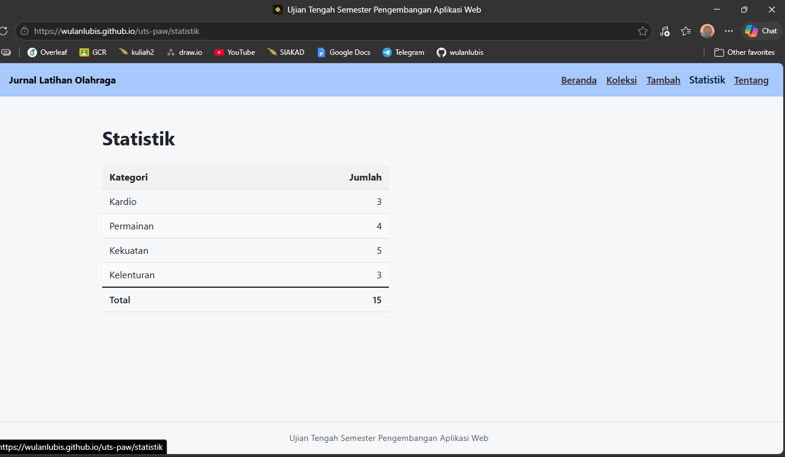
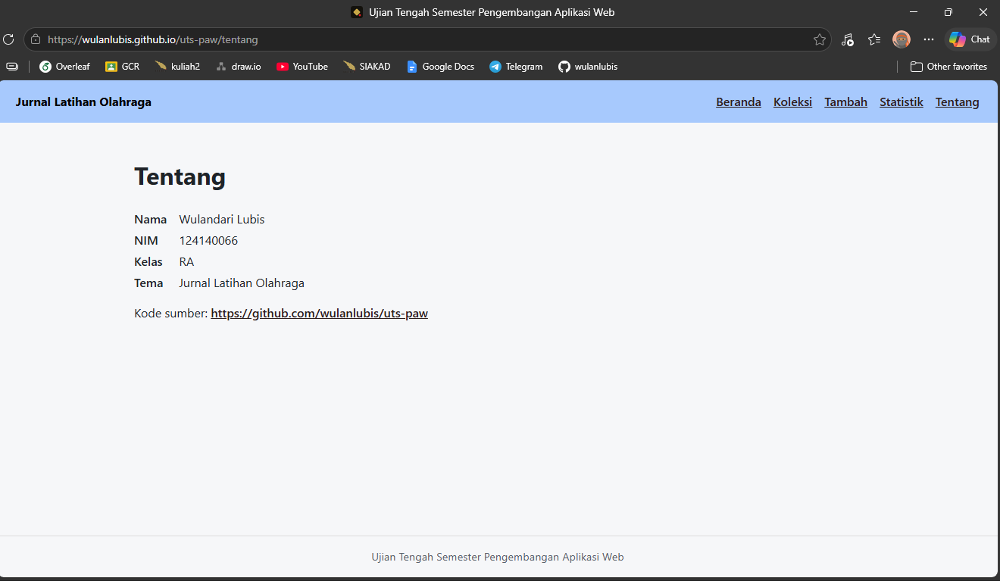

# Ujian Tengah Semester IF25-22014 Pengembangan Aplikasi Web

# Jurnal Latihan Olahraga

| Informasi Mahasiswa | Detail |
| :--- | :--- |
| **Nama** | Wulandari Lubis |
| **NIM** | 124140066 |
| **Kelas** | RA |
| **Tema** | Jurnal Latihan Olahraga |
| **Deployment** | https://wulanlubis.github.io/uts-paw/ |

---

## Screenshot Tampilan Aplikasi

| Page Beranda | Page Koleksi | Page Detail |
| :--- | :--- | :--- |
|  |  |  |

| Page Tambah | Page Statistik | Page Tentang |
| :--- | :--- | :--- |
|  |  |  |


## Fitur

- Memuat data awal koleksi Jurnal Latihan Olahraga dari koleksi.json ke localStorage.
- **Manajemen koleksi dengan CRUD**:
   - Menampilkan daftar jurnal latihan olahraga.
   - Menambah riwayat latihan baru dengan lengkap sesuai dengan kategori, durasi, tanggl, serta info    kalori yang dihitung secara otomatis.
   - Menghapus data latihan dari koleksi.
- **Pencarian dan Filter**:
   - Pencarian jenis latihan berdasarkan judul.
   - Filter koleksi berdasarkan kategori latihan (Kerdio, Permainan, Kekuatan, Kelenturan).
- Menampilkan informasi lengkap dari input latihan yang dipilih
- Dilengkapi dengan unit test untuk komponen UI seperti BadgeKategori, FilterKategori, dan KotakPencarian.

## Menjalankan secara lokal

``` bash
cd app
npm install
npm run dev
```

## Konsep React yang dipakai

- JSX dan Components
- State Management (useState)
- Side Effect (useEffect)
- Custom Hooks(useKoleksi, useLocalStorage)
- React Router (useNavigate, useParams, Link)
- Form Handling dan Validation (noValidate dengan role="alert")
